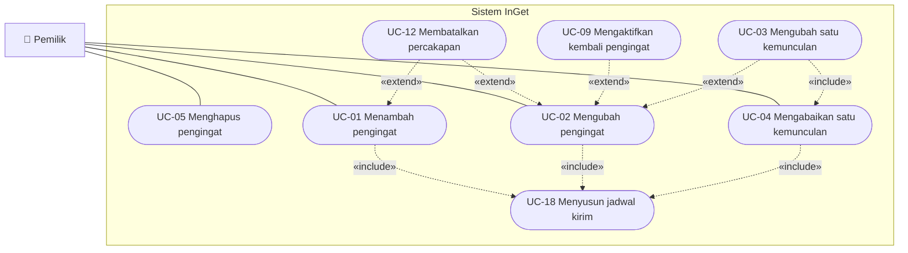
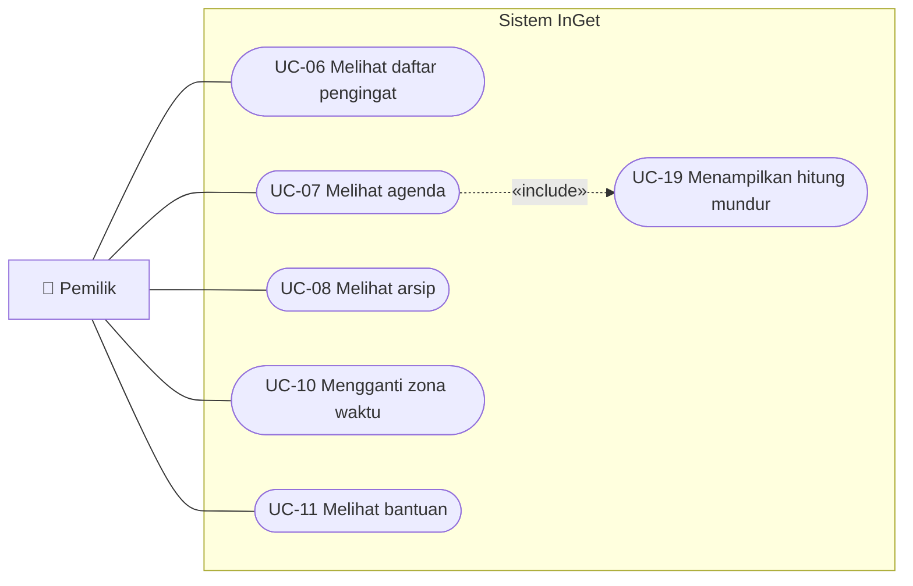
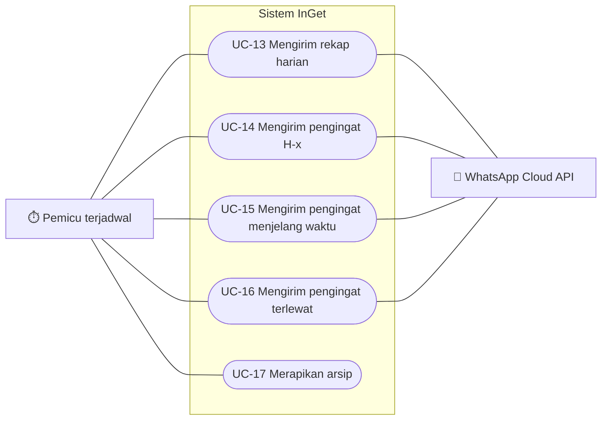

# Use Case Diagram InGet

- **Status:** draf
- **Cakupan:** fase 1 (MVP)
- **Tanggal:** 2026-10-13
- **Sumber:** [dokumen kebutuhan](../kebutuhan.md)

Diagram ini menggambarkan **siapa** berinteraksi dengan InGet dan **apa** yang bisa mereka lakukan, tanpa menjelaskan langkah-langkahnya. Langkah demi langkah digambarkan nanti di activity diagram.

> Mermaid belum memiliki jenis diagram use case bawaan, jadi diagram ini memakai flowchart dengan konvensi UML: aktor di luar batas sistem, use case berbentuk elips, dan relasi `«include»` serta `«extend»` sebagai garis putus-putus.

---

## Aktor

| Aktor | Jenis | Peran |
| --- | --- | --- |
| **Pemilik** | Primer | Satu-satunya pengguna. Mengirim perintah dan menerima pesan |
| **Pemicu terjadwal** | Primer (waktu) | Membangunkan sistem setiap 5 menit untuk mengirim pesan otomatis dan merapikan arsip |
| **WhatsApp Cloud API** | Sekunder | Sistem eksternal yang meneruskan pesan masuk ke InGet dan mengirim pesan keluar ke pemilik |

Semua interaksi pemilik dengan sistem, baik perintah maupun pesan yang diterima, melewati WhatsApp Cloud API. Agar diagram tetap terbaca, use case pemilik dibagi menjadi dua diagram (mengelola pengingat, serta melihat dan mengatur), dan garis ke WhatsApp Cloud API hanya digambar pada use case yang **dimulai oleh sistem**.

---

## Diagram 1: Mengelola pengingat

## Diagram 2: Melihat dan mengatur

## Diagram 3: Use case yang dimulai oleh sistem

Pemilik menerima pesan dari UC-13 sampai UC-16 melalui WhatsApp Cloud API.

---

## Daftar Use Case

### Dimulai oleh pemilik

| ID | Use case | Ringkasan | Kebutuhan |
| --- | --- | --- | --- |
| UC-01 | Menambah pengingat | Lewat percakapan terpandu atau perintah satu baris. Diakhiri bubble konfirmasi | FR-01, FR-01a, FR-02 |
| UC-02 | Mengubah pengingat | Perubahan berlaku untuk semua kemunculan berikutnya | FR-04, FR-01a, FR-02 |
| UC-03 | Mengubah satu kemunculan | Varian UC-02 untuk satu tanggal saja: kemunculan asli diabaikan, lalu dibuat pengingat sekali yang baru | FR-05, BR-15 |
| UC-04 | Mengabaikan satu kemunculan | Satu tanggal kemunculan dilewati | FR-06 |
| UC-05 | Menghapus pengingat | Termasuk jadwal kirim yang belum terkirim | FR-07 |
| UC-06 | Melihat daftar pengingat | Semua pengingat aktif beserta ID-nya | FR-03 |
| UC-07 | Melihat agenda | Rencana hari ini atau besok, satu bubble per kegiatan | FR-08, FR-09 |
| UC-08 | Melihat arsip | Pengingat yang selesai dalam 30 hari terakhir | FR-15 |
| UC-09 | Mengaktifkan kembali pengingat | Varian UC-02 untuk pengingat di arsip: tanggalnya diubah ke masa depan | FR-16 |
| UC-10 | Mengganti zona waktu | WIB, WITA, atau WIT | FR-18 |
| UC-11 | Melihat bantuan | Daftar perintah, termasuk contoh perintah satu baris | FR-19 |
| UC-12 | Membatalkan percakapan | Hanya bisa terjadi saat percakapan terpandu UC-01 atau UC-02 sedang berjalan | FR-01b |

### Dimulai oleh sistem

| ID | Use case | Ringkasan | Kebutuhan |
| --- | --- | --- | --- |
| UC-13 | Mengirim rekap harian | Pukul 00.05: bubble H-x, lalu kegiatan hari ini, atau "Tidak ada kegiatan hari ini" | FR-11, FR-11c |
| UC-14 | Mengirim pengingat H-x | Untuk pengingat bermode Notifikasi, sebagai bagian dari rangkaian rekap harian | FR-11a |
| UC-15 | Mengirim pengingat menjelang waktu | N menit sebelum jam kegiatan | FR-11b |
| UC-16 | Mengirim pengingat terlewat | Pesan yang tertunda karena gangguan dan sudah lewat waktunya | FR-12, FR-13 |
| UC-17 | Merapikan arsip | Menandai pengingat yang selesai dan menghapus yang lebih dari 30 hari | FR-14, FR-17 |

### Use case pendukung (hanya lewat «include»)

| ID | Use case | Dipakai oleh | Kebutuhan |
| --- | --- | --- | --- |
| UC-18 | Menyusun jadwal kirim | UC-01, UC-02, UC-04 (dan secara tidak langsung UC-03, UC-09) | BR-18 |
| UC-19 | Menampilkan hitung mundur | UC-07 | FR-10 |

---

## Arti Relasi

| Relasi | Arti | Contoh di diagram |
| --- | --- | --- |
| Garis biasa | Aktor memulai atau terlibat dalam use case | Pemilik memulai UC-07 |
| `«include»` | Use case **selalu** menjalankan use case lain sebagai bagiannya | Setiap kali pengingat ditambah, jadwal kirim selalu disusun |
| `«extend»` | Use case **kadang** menambahkan perilaku ke use case lain, pada kondisi tertentu | Mengubah satu kemunculan adalah UC-02 dengan kondisi "hanya satu tanggal" |

Arah panah `«extend»` menunjuk dari use case tambahan **ke** use case dasarnya, sesuai konvensi UML.

---

## Hal yang Tidak Digambarkan

Butir berikut berlaku untuk **semua** use case yang dimulai oleh pemilik, sehingga tidak digambar sebagai use case tersendiri agar diagram tetap terbaca:

- **Verifikasi webhook dan nomor pengirim** (FR-21, NFR-10): pesan dengan tanda tangan tidak valid atau dari nomor selain pemilik diabaikan sebelum use case apa pun berjalan.
- **Pesan kesalahan** (FR-20): setiap use case yang menerima input dapat membalas dengan pesan kesalahan.
- **Pencegahan pesan ganda** (NFR-02): berlaku untuk semua pesan masuk dan keluar.

## Riwayat Dokumen

| Tanggal | Perubahan |
| --- | --- |
| 2026-10-13 | Draf pertama, disusun dari dokumen kebutuhan per 2026-10-13 |
